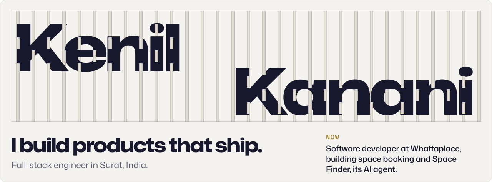
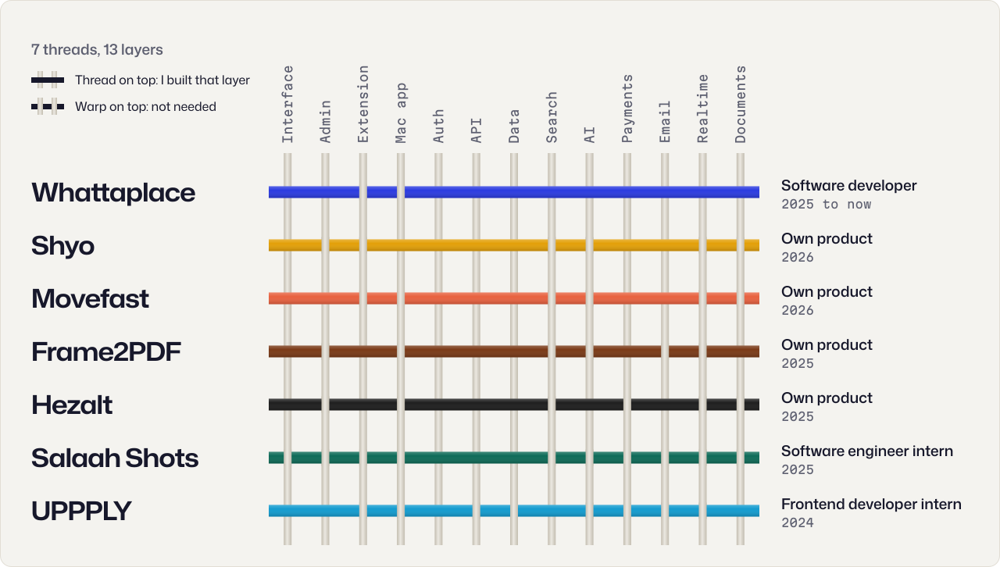
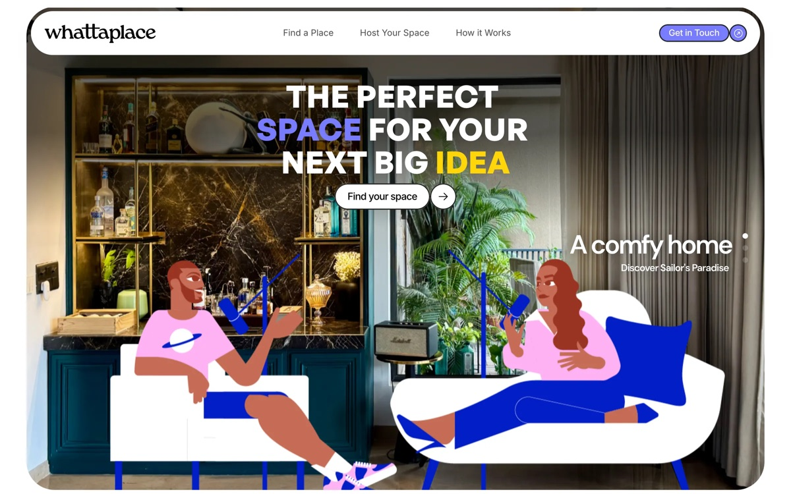
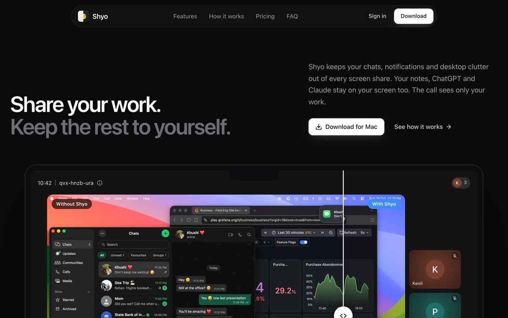
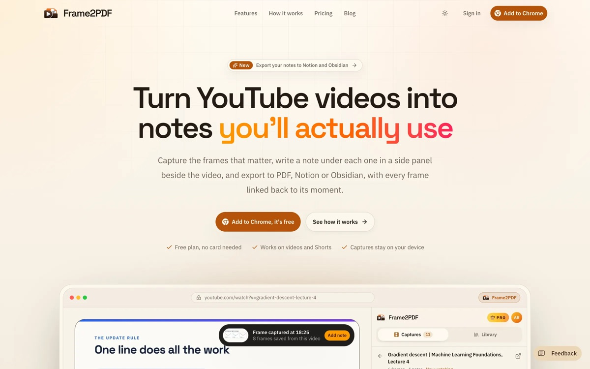
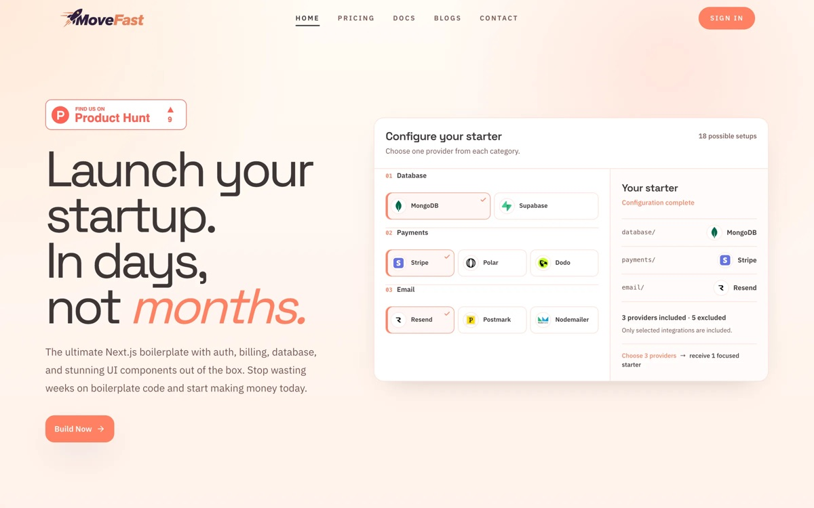

<a href="https://www.kenill.me">
  <picture>
    <source media="(prefers-color-scheme: dark)" srcset="./assets/header-dark.svg">
    
  </picture>
</a>

I take products from an idea to people using them, at startups and on my own. Most of my work sits where products get complicated: payments and invoices with real tax rules, roles and permissions for several kinds of user, search that understands what people mean, and AI agents that act on live data.

<a href="https://www.kenill.me"><b>kenill.me</b></a> &nbsp;·&nbsp;
<a href="https://www.linkedin.com/in/kenill/">LinkedIn</a> &nbsp;·&nbsp;
<a href="https://x.com/kenil__k">X</a> &nbsp;·&nbsp;
<a href="mailto:private.kenil@gmail.com">private.kenil@gmail.com</a>

## Work

<a href="https://www.kenill.me/#work">
  <picture>
    <source media="(prefers-color-scheme: dark)" srcset="./assets/loom-dark.svg">
    
  </picture>
</a>

Each product is a thread passed across the thirteen layers of the stack. It comes to the surface wherever I built that layer.

## Shipped

<table>
  <tr>
    <td width="50%" valign="top">
      
        
      <b><a href="https://whattaplace.com">Whattaplace</a></b> &nbsp;Software developer · 2025 to now
        
      A platform for finding, hosting and booking spaces. I build the booking system end to end, with Razorpay payments and GST invoices, and Space Finder, an AI agent that finds a space and drafts the request.
        
      <code>Next.js</code> <code>Prisma</code> <code>pgvector</code> <code>OpenAI Agents SDK</code>
    </td>
    <td width="50%" valign="top">
      
        
      <b><a href="https://shyo.app">Shyo</a></b> &nbsp;Own product · 2026
        
      A Mac app that keeps private apps, notifications and desktop clutter out of screen shares. The call gets a clean, live copy of your screen; you still see everything.
        
      <code>Swift</code> <code>SwiftUI</code> <code>ScreenCaptureKit</code> <code>Next.js</code>
    </td>
  </tr>
  <tr>
    <td width="50%" valign="top">
      
        
      <b><a href="https://frame2pdf.com">Frame2PDF</a></b> &nbsp;Own product · 2025
        
      A Chrome extension that turns YouTube videos into notes. Capture the frames that matter, write under each one, and export to PDF, Notion or Obsidian.
        
      <code>Plasmo</code> <code>React</code> <code>pdf-lib</code> <code>Cloudflare R2</code>
    </td>
    <td width="50%" valign="top">
      
        
      <b><a href="https://movefa.st">Movefast</a></b> &nbsp;Own product · 2026
        
      A Next.js starter for SaaS. Pick a database, a payment provider and an email service, and get a codebase already wired for that combination.
        
      <code>Next.js</code> <code>Stripe</code> <code>Supabase</code> <code>Resend</code>
    </td>
  </tr>
</table>

Also **[Hezalt](https://hezalt.com)**, a Chrome extension that fills job applications in one click, with an LLM writing answers from your real experience. 100+ registered users.

## How I work

> I like the early, messy part of a product: working out what to build and how to make it work with what you have. Pick the right tool, ship it, learn from the people using it, and keep the code clean enough to move fast again tomorrow.

## Stack

<picture>
  <source media="(prefers-color-scheme: dark)" srcset="https://skillicons.dev/icons?i=ts%2Creact%2Cnextjs%2Cnodejs%2Cexpress%2Ctailwind%2Cpostgres%2Cprisma%2Csupabase%2Cmongodb%2Cfirebase%2Cswift%2Ccloudflare%2Caws%2Cvercel%2Cgit&perline=8&theme=dark">
  
</picture>

Also OpenAI Agents SDK, embeddings and pgvector, Stripe, Razorpay, Polar, Resend, Stream Chat, Algolia, Plasmo and ScreenCaptureKit.
